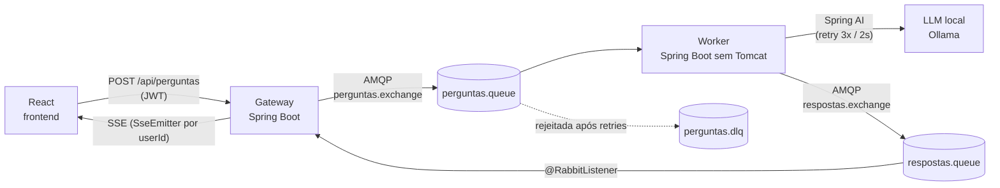

# Sistema de Tutoria Assíncrono com IA

Projeto da disciplina de Desenvolvimento Web.

- Grupo: Marianna Lima, Lucca Chatack e Julia Staudohar.

Sistema distribuído de perguntas e respostas: o aluno envia uma pergunta pelo React, o Gateway
Spring Boot a publica no RabbitMQ, um Worker (Spring Boot sem Tomcat) consulta uma LLM via
**Spring AI** e a resposta volta ao navegador em tempo real via **SSE**, com autenticação **JWT**.

## Arquitetura



1. O React envia a pergunta com o JWT. O Gateway gera um `correlationId`, publica a mensagem
   (com *publisher confirm*) e responde **202 Accepted** na hora, sem esperar a LLM.
2. O Worker consome `perguntas.queue` (prefetch 1: cada Worker pega uma pergunta por vez),
   aplica a máscara de tutor ao prompt e chama a LLM pelo `ChatClient` do Spring AI.
3. Se a LLM falhar (rede, 5xx, rate limit) o Worker espera 2 s e tenta de novo (3 tentativas).
   Esgotadas as tentativas, publica uma resposta `ERROR` (o usuário é avisado) e manda a pergunta
   para a `perguntas.dlq`.
4. A resposta, com o mesmo `correlationId`, vai para `respostas.queue`. O Gateway consome com
   `@RabbitListener`, encontra o `SseEmitter` do usuário num `ConcurrentHashMap` e envia o evento.
5. O React (com `@microsoft/fetch-event-source`, que permite mandar o JWT no header) recebe o
   evento `resposta` e atualiza a tela.

### Requisitos do enunciado → onde estão no código

| Requisito | Implementação |
|---|---|
| Gateway nunca chama a LLM | `gateway` não tem dependência de Spring AI; só publica em `perguntas.exchange` |
| Worker sem Tomcat | [worker/pom.xml](backend/worker/pom.xml) usa `spring-boot-starter`; `web-application-type: none` |
| Filas duráveis / persistência | [RabbitTopologyConfig](backend/common/src/main/java/br/edu/trabalho/common/messaging/RabbitTopologyConfig.java): exchanges e filas `durable`, mensagens `PERSISTENT`, DLQ |
| Jackson nos dois lados | `Jackson2JsonMessageConverter` no módulo `common`; DTOs `QuestionMessage` / `AnswerMessage` compartilhados |
| Extração de dados + correlation_id | [QuestionListener](backend/worker/src/main/java/br/edu/trabalho/worker/messaging/QuestionListener.java) |
| Prompt engineering | [PromptEnricher](backend/worker/src/main/java/br/edu/trabalho/worker/tutor/PromptEnricher.java) + `app.tutor` no `application.yml` |
| Spring AI | [SpringAiTutorLlm](backend/worker/src/main/java/br/edu/trabalho/worker/tutor/SpringAiTutorLlm.java) (`ChatClient`) |
| Retry após falha / rate limit | [QuestionProcessor](backend/worker/src/main/java/br/edu/trabalho/worker/tutor/QuestionProcessor.java) + [WorkerConfig](backend/worker/src/main/java/br/edu/trabalho/worker/config/WorkerConfig.java) |
| AMQP → SseEmitter | [AnswerListener](backend/gateway/src/main/java/br/edu/trabalho/gateway/messaging/AnswerListener.java) + [SseHub](backend/gateway/src/main/java/br/edu/trabalho/gateway/sse/SseHub.java) |
| JWT / stream vinculado ao usuário | [SecurityConfig](backend/gateway/src/main/java/br/edu/trabalho/gateway/security/SecurityConfig.java); o `userId` vem sempre do `sub` do token |
| React: stream estável | [useAnswerStream.js](frontend/src/useAnswerStream.js): reconexão automática, histórico recarregado a cada reconexão |
| Controle de uso da LLM | 5 perguntas/min e 3 pendentes por usuário (HTTP 429), teto de tokens por resposta |

## Como rodar

### Opção 1 — tudo em Docker (mais simples)

Pré-requisitos: Docker Desktop e [Ollama para Windows](https://ollama.com/download), que usa a GPU.

```bash
ollama pull qwen3.5:4b        # ~3,4 GB, uma vez só
docker compose up -d --build
```

Abra **http://127.0.0.1:3000** e entre com `aluno` / `senha123` (ou crie uma conta).
Painel do RabbitMQ: http://127.0.0.1:15672 (`app` / `app`).

**Modelo padrão: `qwen3.5:4b`.** Numa Radeon RX 570 (8 GB) gera ~17 tokens/s: uma resposta
típica (~650 tokens) leva ~40 s, e a primeira chamada leva ~1 min a mais para carregar o modelo
(depois ele fica 30 min em memória). É um modelo com *thinking*; o Worker desliga esse modo
(`LLM_THINKING=false`), senão o modelo gasta o orçamento de tokens raciocinando e devolve
resposta vazia.

Variações do Ollama (definidas num `.env` na raiz):

| Situação | Configuração | Observação |
|---|---|---|
| Sem Ollama instalado | `COMPOSE_OLLAMA_URL=http://ollama:11434` e rodar com `--profile ollama`; baixe o modelo com `docker compose exec ollama ollama pull qwen3.5:2b` | Ollama em Docker, só CPU: use `OLLAMA_MODEL=qwen3.5:2b` |
| Outro modelo | `OLLAMA_MODEL=...` e `ollama pull` do modelo | ou `OLLAMA_PULL_STRATEGY=when_missing` para o Worker baixar ao iniciar |

### Opção 2 — desenvolvimento (Java e Node locais)

Pré-requisitos: JDK 21, Node 22+, Docker Desktop.

```bash
# 1. Infraestrutura (LLM: Ollama para Windows com `ollama pull qwen3.5:4b`)
docker compose up -d rabbitmq

# 2. Backend (na pasta backend/)
cp .env.example .env                              # ajuste OLLAMA_MODEL etc. se quiser
./mvnw package                                    # compila e roda os testes
java -jar worker/target/worker-0.0.1-SNAPSHOT.jar
java -jar gateway/target/gateway-0.0.1-SNAPSHOT.jar

# 3. Frontend (na pasta frontend/)
npm install
npm run dev                                       # http://localhost:5173
```

No Windows use `mvnw.cmd` no lugar de `./mvnw`.

> **Windows:** se `http://localhost:15672` (ou outra porta do Docker) não abrir, use
> `http://127.0.0.1:...`. Com o WSL ativo, `localhost` pode resolver para `::1` e cair num
> encaminhamento do WSL que não responde. Por isso o `.env.example` e o proxy do Vite usam `127.0.0.1`.

## Testes

```bash
cd backend && ./mvnw test
cd frontend && npm run lint
```

- **Gateway** ([GatewayApiTest](backend/gateway/src/test/java/br/edu/trabalho/gateway/GatewayApiTest.java)): rotas exigem JWT,
  login inválido dá 401, a pergunta é publicada com o `userId` do token, um usuário não vê a pergunta
  de outro, validação (400) e rate limit (429).
- **Worker** ([QuestionProcessorTest](backend/worker/src/test/java/br/edu/trabalho/worker/tutor/QuestionProcessorTest.java)):
  enriquecimento do prompt, retry após falhas temporárias, resposta `ERROR` quando as tentativas acabam.

### Roteiro de demonstração (resiliência)

1. **Worker desligado:** `docker compose stop worker`, envie uma pergunta (ela fica "pensando").
   No painel do RabbitMQ, `perguntas.queue` mostra 1 mensagem. `docker compose start worker`
   e a resposta chega na tela.
2. **LLM fora do ar:** feche o Ollama (ícone da bandeja → Quit) e envie uma pergunta. Nos logs
   (`docker compose logs -f worker`) aparecem 3 tentativas com 2 s de intervalo. A tela mostra a
   mensagem de erro e a pergunta vai para `perguntas.dlq`.
3. **Vários Workers:** `docker compose up -d --scale worker=3` e envie várias perguntas (de
   usuários diferentes). O RabbitMQ distribui entre os Workers livres.
4. **Isolamento:** abra duas janelas (uma anônima) com usuários diferentes. Cada um só recebe
   as próprias respostas.

## API do Gateway

| Método | Rota | Auth | Descrição |
|---|---|---|---|
| POST | `/api/auth/login` | — | `{username, password}` → `{token, username, expiresAt}` |
| POST | `/api/auth/register` | — | cria usuário (em memória) e devolve o token |
| POST | `/api/perguntas` | JWT | `{question}` → 202 `{correlationId, status: PENDING, ...}` |
| GET | `/api/perguntas` | JWT | histórico do usuário |
| GET | `/api/perguntas/{correlationId}` | JWT | estado de uma pergunta (404 se for de outro usuário) |
| DELETE | `/api/perguntas` | JWT | "Limpar conversa": apaga o histórico do usuário. Respostas de perguntas que ainda estavam em andamento são descartadas quando chegam |
| GET | `/api/stream` | JWT | SSE: eventos `conectado`, `resposta` e `historico-limpo` (+ `:ping` a cada 15 s) |

## Decisões e limitações

- **SSE em vez de STOMP:** é a alternativa que o enunciado aponta como mais simples. O JWT vai
  no header de uma requisição HTTP comum, validado pelo Spring Security.
- **Stream persistente por usuário:** o enunciado menciona `emitter.complete()` ao fim de cada
  resposta, mas também pede um stream "estável e vinculado ao usuário". Optamos por uma conexão
  por usuário (aberta no login) que recebe todas as respostas. Isso evita uma corrida: a resposta
  poderia chegar antes de o navegador abrir um stream por pergunta. O `complete()` acontece no
  timeout (30 min) e o cliente reconecta sozinho.
- **Respostas não se perdem:** se o navegador estiver desconectado quando a resposta chega, ela
  fica no histórico do Gateway e é recuperada na reconexão (`GET /api/perguntas`).
- **Comportamento do tutor:** o *system prompt* ([application.yml do Worker](backend/worker/src/main/resources/application.yml),
  `app.tutor`) separa três casos. Saudações e agradecimentos recebem resposta curta e natural.
  Dúvidas de Computação (incluindo a matemática do curso) recebem explicação didática:
  intuição, definição, exemplo e resumo. Assuntos fora do tema recebem um aviso educado de que
  ele só é tutor de Computação. O prompt traz exemplos de cada caso, porque eles deixam um modelo
  pequeno como o `qwen3.5:4b` bem mais consistente.
- **Estado em memória:** usuários cadastrados e histórico ficam em memória (reiniciar o Gateway
  apaga). Com mais de uma instância do Gateway seria preciso um broker de eventos entre elas
  (ex.: uma fila por instância). Fora do escopo do trabalho.
